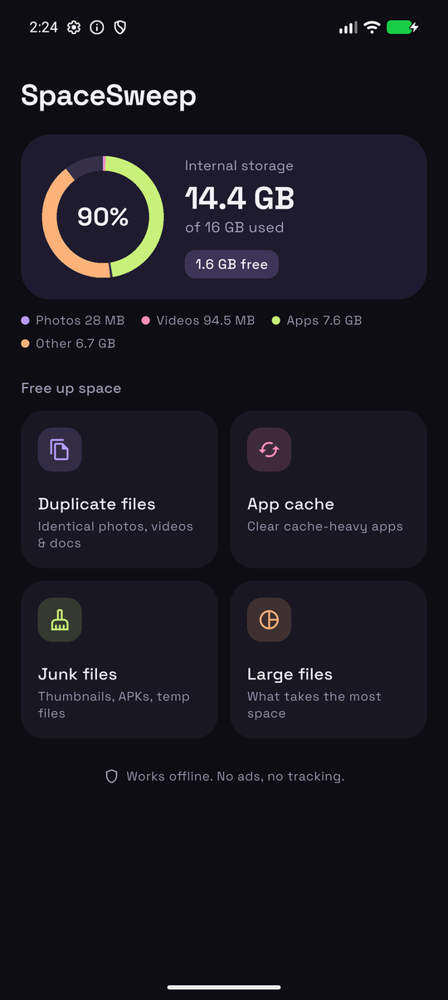
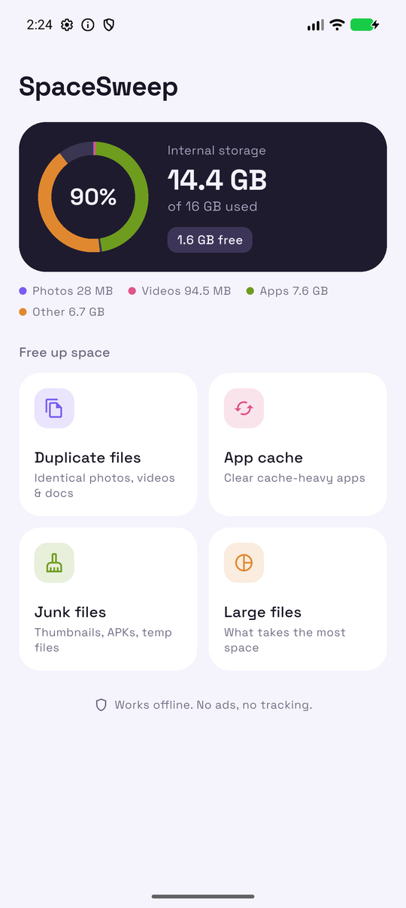
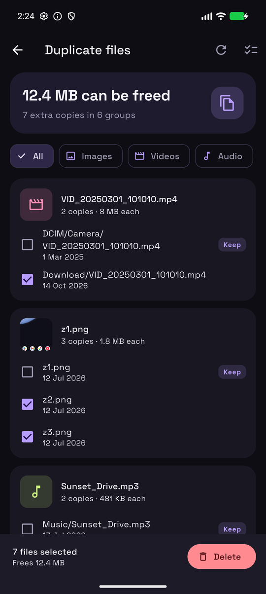
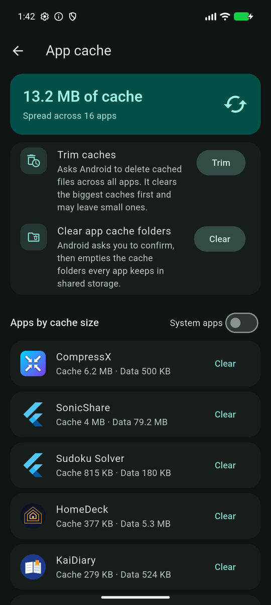
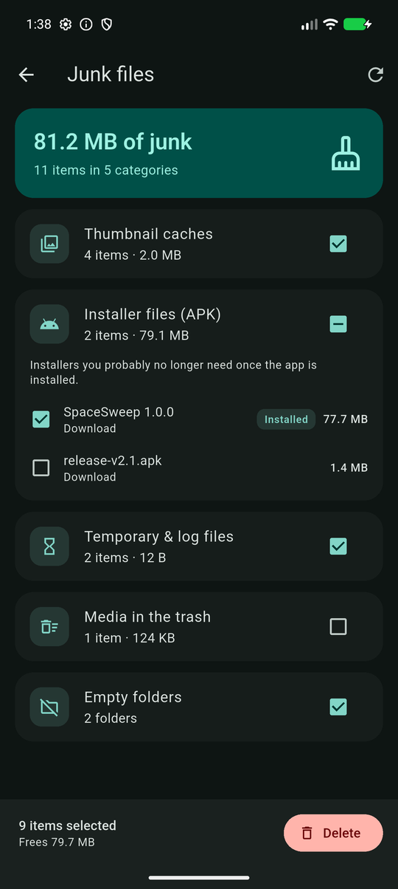
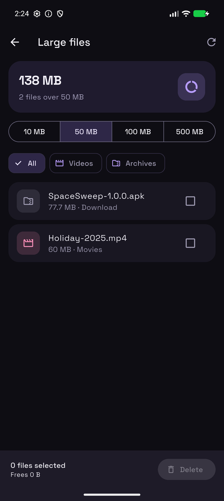
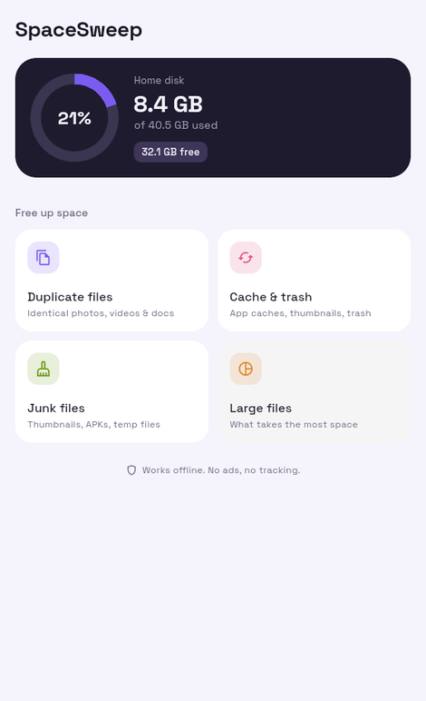
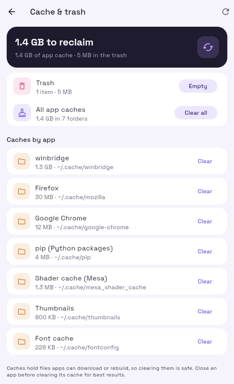

# SpaceSweep

[](https://github.com/Dhiva-Labs/SpaceSweep/actions/workflows/ci.yml)


**Free up space on your Android phone or Linux desktop.** Find duplicate files, clear app caches,
sweep away junk and spot the files eating your storage — all on-device, no ads,
no tracking, no network access.

<p>
  
  
  
</p>
<p>
  
  
  
</p>

The home screen's storage ring splits used space into photos, videos, apps
and everything else (with usage access). The look is "Lilac night": ink-black
and lavender surfaces with lilac, pink, lime and peach accents, set in
[Space Grotesk](https://github.com/floriankarsten/space-grotesk) (SIL OFL 1.1,
bundled in `assets/fonts`, so the app still needs no internet access).

## Features

### Duplicate files
- Compares **file content**, not names: files are grouped by size, then by a
  SHA-256 of three 16 KB samples (start, middle, end), and only the remaining
  candidates are hashed in full. Most files are never read completely.
- Groups are sorted by how much space they'd free, with image thumbnails and
  filters for images, videos, audio, documents and archives.
- One copy is pre-marked **Keep** — the oldest by default, or the newest, or
  the shortest path.
- Ignores files below a size you choose (1 KB – 1 MB) and, unless you opt in,
  hidden folders.

### App cache
- Lists every app by cache size (system apps optional), with icons.
- **Trim caches** — asks Android to delete cached files across *all* apps in
  one tap (`StorageManager.allocateBytes`). Android clears the largest caches
  first and may leave small ones alone.
- **Clear app cache folders** (Android 11+) — Android's own confirmation dialog
  that empties every app's cache folder in shared storage
  (`ACTION_CLEAR_APP_CACHE`).
- **Per-app Clear** — opens the app's settings page; when you come back,
  SpaceSweep shows how much you freed.

### Junk files
| Category | What | Pre-selected |
|---|---|---|
| Thumbnail caches | `.thumbnails` folders galleries rebuild on demand | yes |
| Installer files | `.apk/.apks/.xapk/.apkm`, with app name and version | only if that version (or newer) is installed |
| Temporary & log files | `.tmp`, `.part`, `.crdownload`, `~$` lock files, `.log` — **older than a day** | yes |
| Media in the trash | `.trashed-*` files waiting in the system trash | no |
| Empty folders | folders with nothing inside | yes |

### Large files
The biggest files over 10 / 50 / 100 / 500 MB, filterable by type.

## Linux edition

The same app runs on the Linux desktop (x86-64 and ARM64), published as the
`spacesweep` snap:

<p>
  
  
</p>

```bash
sudo snap install spacesweep
```

- Duplicate, junk and large-file scans cover your Desktop, Documents,
  Downloads, Music, Pictures and Videos folders (localised names come from
  `~/.config/user-dirs.dirs`). The rest of your home folder, including
  source trees, SDKs and app data, is never scanned.
- **Cache & trash** replaces the Android cache screen: every folder in
  `~/.cache` by size, cleared one at a time or all at once (contents only),
  plus emptying the desktop trash.

Or download the tarball for your machine from the
[Releases](https://github.com/Dhiva-Labs/SpaceSweep/releases) page,
`SpaceSweep-<version>-linux-x64.tar.gz` (x86-64) or
`SpaceSweep-<version>-linux-arm64.tar.gz` (ARM64 / aarch64), extract it and run
`./space_sweep`. It needs the GTK 3 runtime (`libgtk-3-0`). Outside the snap
the app works on your real home folder directly.

If the snap's file plugs aren't connected yet (they need a store grant to
connect automatically), connect them once:

```bash
sudo snap connect spacesweep:dot-cache
sudo snap connect spacesweep:trash
sudo snap connect spacesweep:user-dirs
```

See [packaging/SNAP.md](packaging/SNAP.md) for how the snap is built and
confined.

## About clearing other apps' caches

Since Android 6, only system apps may wipe another app's internal cache
directly (`CLEAR_APP_CACHE` is a signature permission). "Cleaner" apps that
claim one-tap total cache clearing either drive Settings through accessibility
automation or don't actually clear anything. SpaceSweep uses only the supported
routes above. Verified on an Android 17 emulator: Trim removed a 400 MB cache
planted in another app, and the per-app flow measured 163 MB freed from Gboard.

## Safety

Deletes are re-checked at the moment they happen:

- A duplicate group always keeps at least one copy, and nothing in the group
  is deleted unless that kept copy is still on disk unchanged.
- Any file whose size or modification time changed since the scan — or that
  became a symlink — is skipped, not deleted.
- Nothing outside shared storage, or inside `Android/data` / `Android/obb`, is
  ever touched. Symlinks are never followed.
- "Empty" folders are re-checked for content right before removal; standard
  folders (`DCIM`, `Download`, `Music`, …), hidden folders and the `Android`
  tree are never reported as empty.
- With a filter active, Delete only acts on what's on screen.
- Deleted media is removed from the media store so galleries don't show ghosts.

## Permissions

| Permission | Why |
|---|---|
| `MANAGE_EXTERNAL_STORAGE` (Android 11+) / storage (Android 8–10) | Scan and delete files in shared storage |
| `PACKAGE_USAGE_STATS` (usage access) | Read other apps' cache sizes |
| `QUERY_ALL_PACKAGES` | List installed apps on the cache screen and match APKs to installed apps |

No internet permission. Google Play restricts all-files access and
`QUERY_ALL_PACKAGES` to approved use cases, so a Play release would need a
permissions declaration.

## Building

Requires Flutter 3.44+, plus the Android SDK for Android builds. Runs on Android 8.0 (API 26) or newer, and on Linux (x86-64 and ARM64).

```bash
flutter test                 # unit + widget tests
flutter build apk --release
flutter build linux --release
packaging/build_tarball.sh   # -> dist/SpaceSweep-<version>-linux-<x64|arm64>.tar.gz
```

Flutter cannot cross-compile the Linux desktop target: the bundle lands in
`build/linux/x64/release/bundle` on an x86-64 machine and in
`build/linux/arm64/release/bundle` on an ARM64 one, and `build_tarball.sh`
packs the one for the machine it runs on.

Release builds are signed with the key referenced by `android/key.properties`
(gitignored, like the keystore it points at). Without that file they fall back
to the debug key and Gradle prints a warning.

Official APKs are signed with this certificate:

```
SHA-256: fa:00:f4:e9:2f:1a:07:74:42:a6:67:5a:b8:26:ad:0c:48:c9:ac:72:8c:ec:7c:c2:5b:8f:05:87:3e:11:ce:cd
```

Check a download with `apksigner verify --print-certs SpaceSweep-*.apk`.

Code layout:

```
lib/src/scan/      walker, duplicate finder, junk & large-file scanners, isolate runner
lib/src/clean/     Cleaner: re-checked, guarded deletion
lib/src/platform/  StorageBridge (method channel "space_sweep/storage")
lib/src/ui/        screens
android/.../StorageChannel.kt   StorageStatsManager, allocateBytes, ACTION_CLEAR_APP_CACHE, APK info
```

Scans run on a background isolate and can be cancelled.
